<p align="center">
  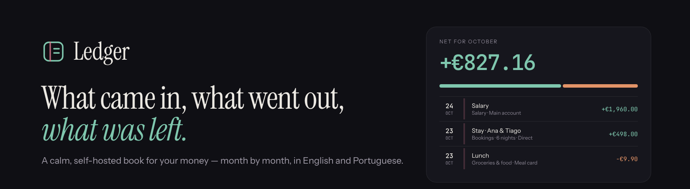
</p>

<p align="center">
  A <b>self-hosted</b>, calm book for your money: what came in, what went out and what was left, month by month —
  where it went, how much you kept and where it sits. Your <b>main account</b> first; a <b>short-term rental</b> and a
  <b>buy-to-renovate-and-sell</b> project when you have them. On the phone and on the computer, in English and Portuguese,
  on your own server.
</p>

<p align="center">
  
  
  
  
  
  
</p>

<p align="center">
  <a href="#features">Features</a> ·
  <a href="#screenshots">Screenshots</a> ·
  <a href="#deploying-on-the-nas">Deploying on the NAS</a> ·
  <a href="#demo-mode">Demo mode</a> ·
  <a href="#your-data">Your data</a> ·
  <a href="#sign-in-with-discord">Discord</a> ·
  <a href="#development">Development</a>
</p>

<p align="center">
  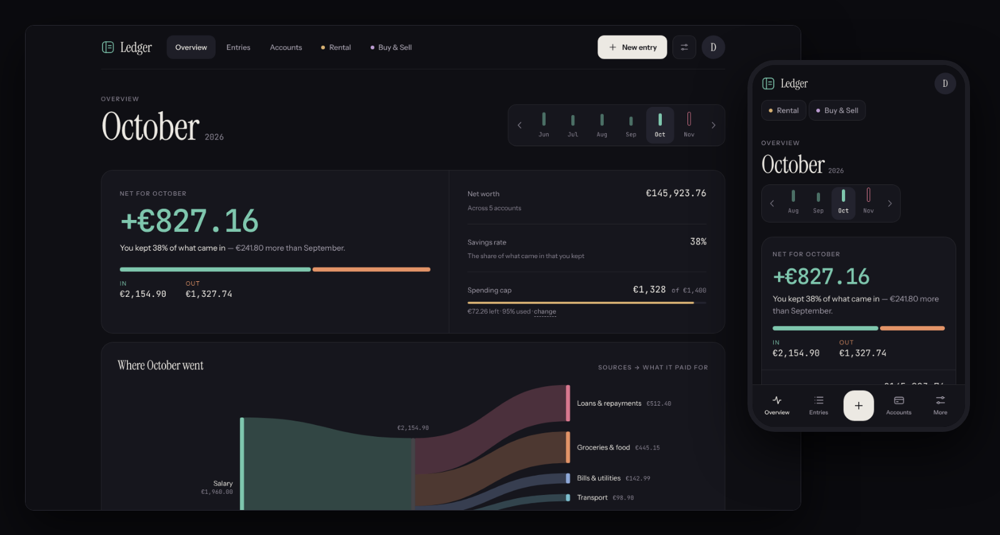
</p>

> Everything is typed in by you — Ledger doesn't connect to a bank. It never reaches out to the internet: your numbers
> stay in your database, on your NAS.

---

## Features

**Overview** — the month of your own money

- **The net for the month** in one big number, and the one sentence worth knowing: *"You kept 38% of what came in —
  €241.80 more than September."* In and out side by side, as a split bar.
- **Six months at a glance** above it: a bar for each month's net (jade kept, wine short; the month in progress is
  hollow). Tap one to open it; the arrows walk further back.
- **Net worth** across every account, the **savings rate**, and an optional **spending cap** for the month — the meter
  turns brass from 80% and wine once it's passed.
- **Where the month went**: a flow (Sankey) from every source of income on the left to everything it paid for on the
  right, each ribbon as thick as its amount; what was left over is the last ribbon. A month that spent more than came
  in shows *"From your balance"* on the left instead, so both sides always add up.
- **Biggest movers**: the categories, biggest first, outflows or inflows. Tap one for its entries.
- The overview is only the **personal** money: the rental and the projects have their own tabs and never mix into it.

**Entries**

- **Quick add**: type `9.80 lunch` and press Enter. Ledger finds the amount (`9,80`, `1.960,00` and `1,960.00` all
  work), guesses the category from the words — in English or Portuguese (*almoço, Pingo Doce, Via Verde, ginásio,
  salário…*) — puts a meal on the **meal card**, and remembers what you chose for those words next time. `+1850 salary`
  is money coming in. The chips under the box show what it understood; tap one to open the full form.
- **The full form** in a sheet: outflow, inflow or **transfer** between accounts (it moves both balances and never
  counts as spending), a big amount, the categories that fit, the account, the day.
- **The month's list** in a ledger's margin — the day on the left of a double rule — filtered by part of life
  (Everything, Personal, Rental, Buy & Sell) and by category.
- **33 categories** (24 out, 9 in) with their own colour, among them **Gym & fitness**, Meal allowance, and the ones only the modules
  use (cleaning, platform fees, guest supplies; purchase, transfer tax & deed, works, labour, agency…).

**Instalments and one-offs**

- **Pay in instalments, interest-free**: tick it on a new outflow, pick 3, 6, 10, 12, 24 (or any number up to 60), the
  day of the first instalment and whether the others fall on **the first business day of each month** (weekends and
  Portuguese national holidays skipped) or on the same day. Ledger writes one entry per month, split to the cent, each
  in its own month — and the account balances only move on the day each one is paid.
- **Instalments** on the overview: every plan with instalments still to come, the next one, how many are left and
  what is still to pay. Open any instalment to delete the whole plan.
- **Selling or buying a car or a motorbike** has its own categories (*Vehicle sale*, *Vehicle purchase*). They count
  in the month like anything else, but the **savings rate leaves them out**, so one sale doesn't make a month look like
  the best ever; the overview says what it includes.

**Accounts**

- **Main account, Savings, Investments, Meal card** to start with; add, rename or remove your own (removing one keeps
  its entries). Each has an opening balance, then every entry moves it.
- **Drag them into your order** by the handle (or with the arrow keys); the order follows you everywhere.
- **Net worth** and how it's spread across them; each account's change this month.

**Short-term rental** — optional

- **Revenue, costs, margin and occupancy** for the month, the average booking and the **nightly rate**.
- **The month's nights** on a calendar, each booking a bar across its nights (a stay that started last month shows too).
- **Where the revenue goes**: each cost as a share of what guests paid — *"Of every €100 a guest pays, €51 stays with
  you."*
- **The bookings** with their stretch, channel (Airbnb, Booking, direct) and nightly rate, and **the year so far**.

**Buy & Sell** — optional

- **A project per property**: file the deposit, the deed, the works and the sale under it.
- **Realised profit, return on sold projects, capital at work** and the average days **from deposit to sale**.
- Each project's **timeline** — deposit paid, deed signed, works, on the market — worked out from its entries.
- **Where the money went**: purchase, taxes, works, labour, agency… and the profit, as one bar.
- **What does it need to sell for?** Give the price agreed with the seller, a works budget and a target sale, and
  Ledger tells you what would be left and the return — counting the part of the price still to pay and the works still
  to do.

**Your bank and your investments** — optional

- **Your bank account, read only**: connect Crédito Agrícola (or most Portuguese banks) through
  [Enable Banking](https://enablebanking.com) — open banking (PSD2), you authorise at the bank itself. Its movements
  come in every few hours on their own: what you already wrote by hand is **recognised and not added twice** (same
  account, same amount, up to 3 days apart), the rest comes in **"to review"** with a guessed category. The balance
  **agrees with the bank's**, and if it ever drifts Ledger says by how much and matches it in one tap. Deleting a
  movement that came from the bank keeps it out for good.
- **Several accounts at the same bank** (say the main one and the savings): connect them in one go and give each its
  Ledger account. Money moved between them becomes **one transfer** — not spending in one and income in the other —
  whether you wrote it down first or not.
- **Investments from Obol**: an account can take its balance from [Obol](https://github.com/rodrigocoelho2/Obol) —
  what the portfolio is worth, refreshed every half hour, with the month's gain or loss on the Overview.

**Modules you switch on**

- Your **main account is always there**. The rental and Buy & Sell are **off until you switch them on** in Settings;
  switching one off hides its tab and deletes nothing.

**Built to self-host**

- **No SQL Server of its own**: it uses the **shared SQL Server** already on the NAS (`shared-sql`, network `sql-net`)
  with **its own login** (`ledger`) that can only open the Ledger database. The one-shot **database deploy** creates
  the database and that login as sa, and brings both up to date on every update.
- **Accounts for the house**: everyone has their own ledger; the first account (protected by a setup key) is the admin.
  Sign-ups can be closed. **Sign in with Discord** too.
- **English and Portuguese**, per account (words, dates and how amounts are written: `€1,327.74` or `1 327,74 €`).
- **Dark by default, light if you like** (per device). Instrument Serif for the headings, Instrument Sans for the text,
  JetBrains Mono for every figure so the columns line up — all shipped with the app.
- **Phone and computer**: the same pages, a top bar on the computer and a dock with a big **+** on the phone; adds to
  the Home Screen like an app.

## Screenshots

### On the phone
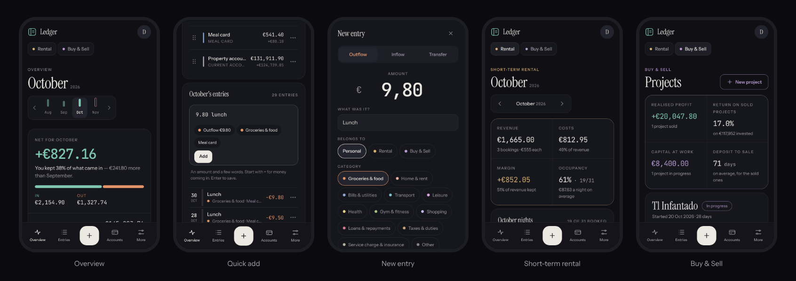

<details>
<summary>Entries, accounts, settings, and in Portuguese</summary>
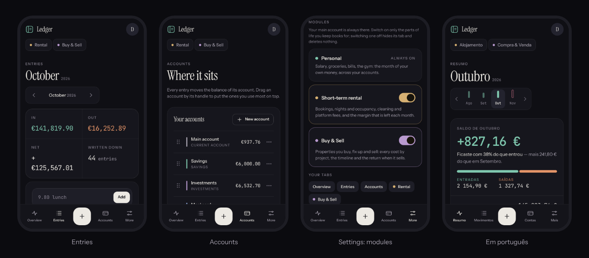
</details>

### On the computer
<table>
<tr>
<td width="50%"><b>Overview</b><br>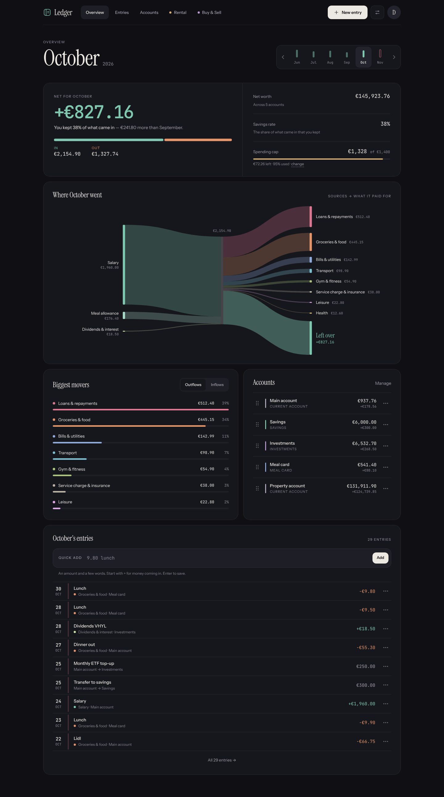</td>
<td width="50%"><b>Short-term rental</b><br>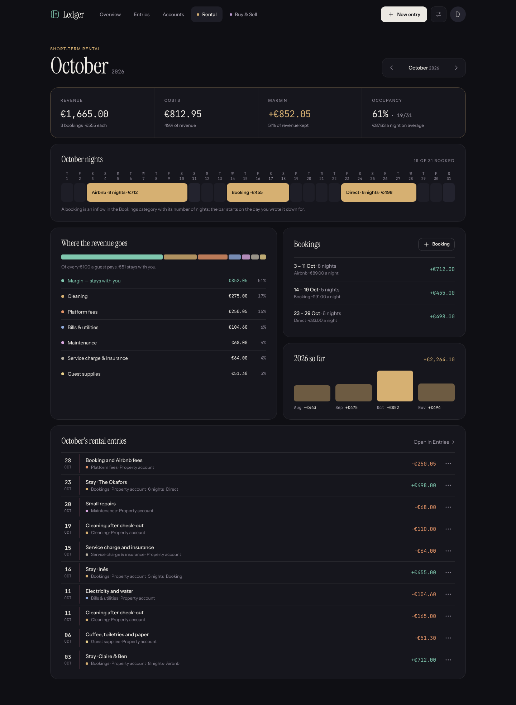</td>
</tr>
<tr>
<td width="50%"><b>Buy & Sell</b><br>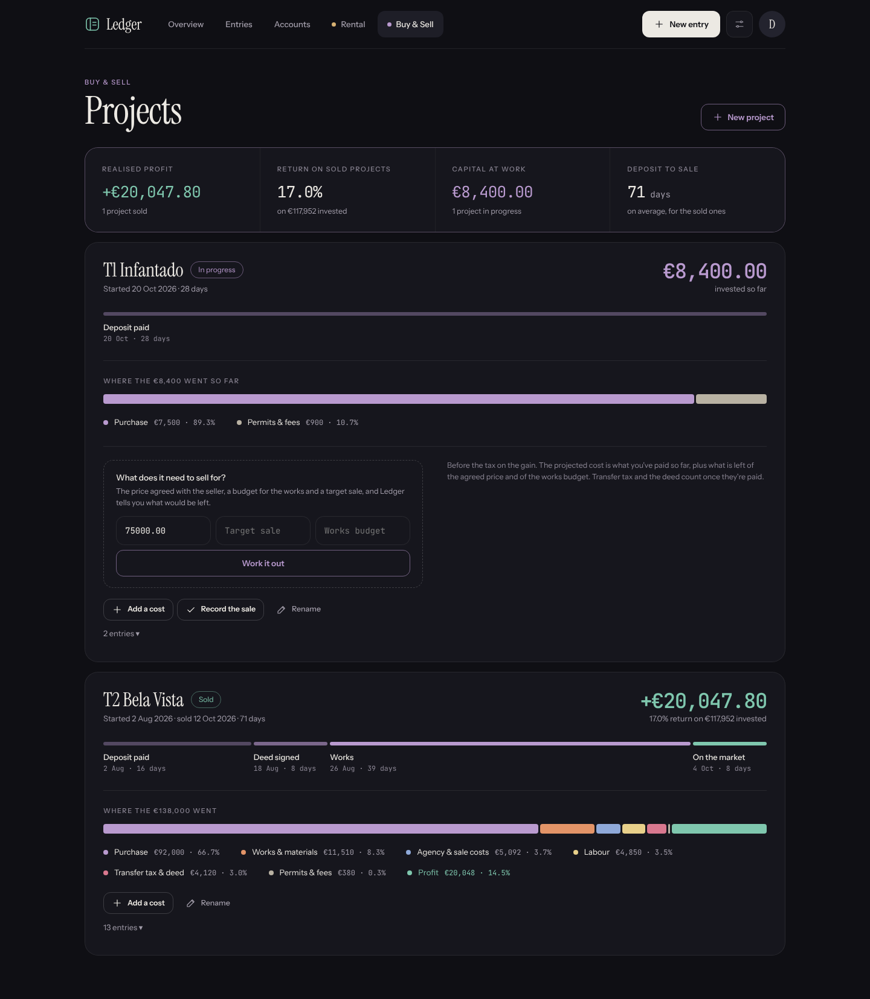</td>
<td width="50%"><b>Settings</b><br>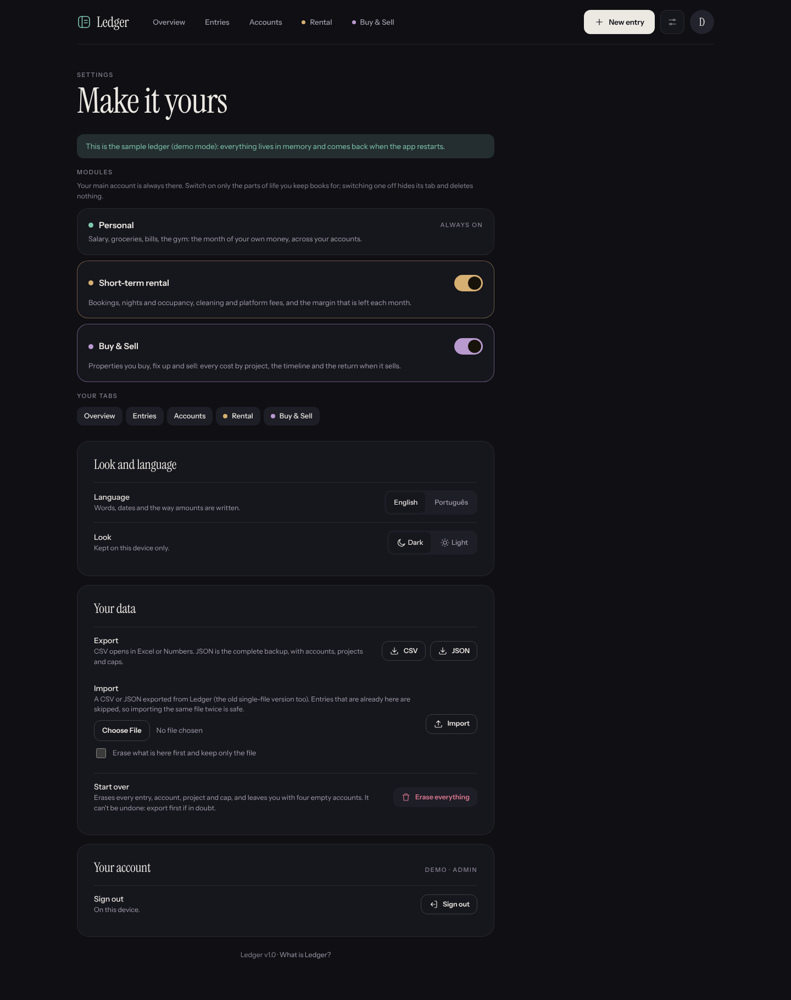</td>
</tr>
<tr>
<td width="50%"><b>Entries</b><br>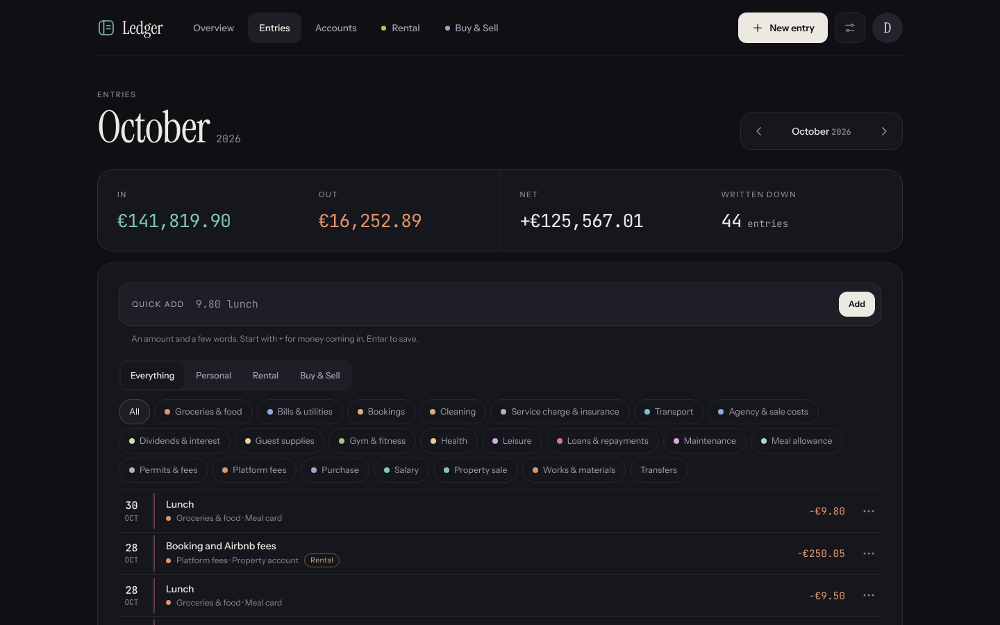</td>
<td width="50%"><b>A new entry</b><br>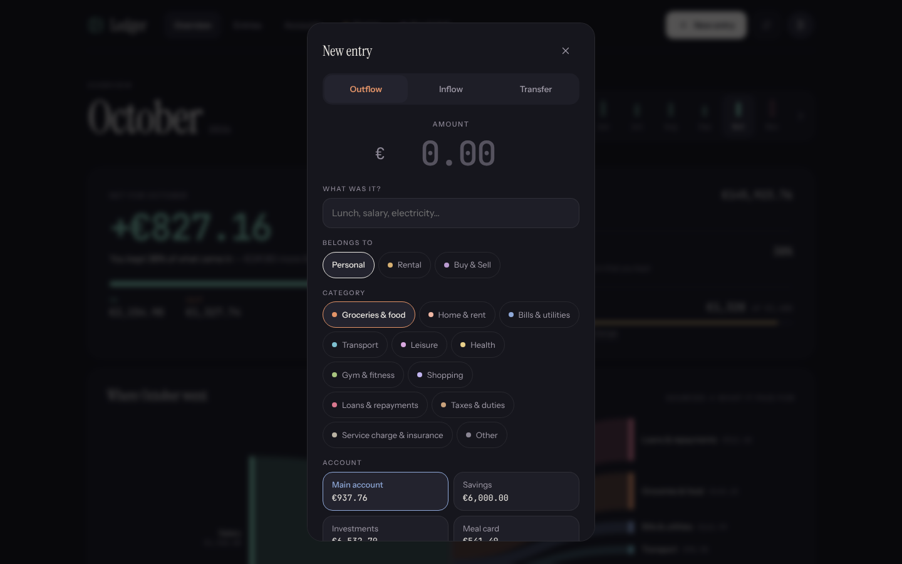</td>
</tr>
<tr>
<td width="50%"><b>Accounts</b><br>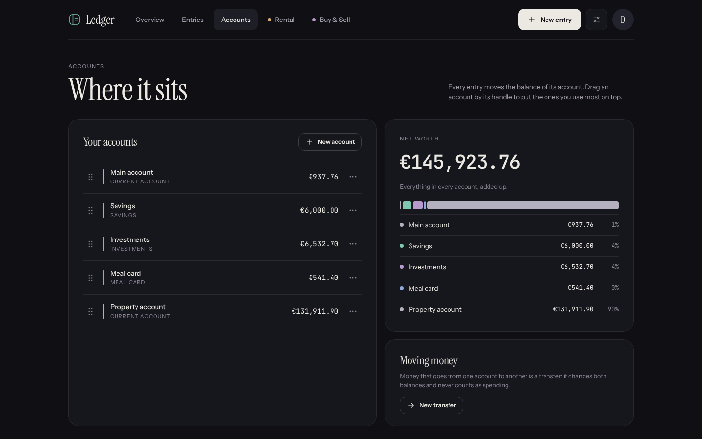</td>
<td width="50%"><b>Em português</b><br>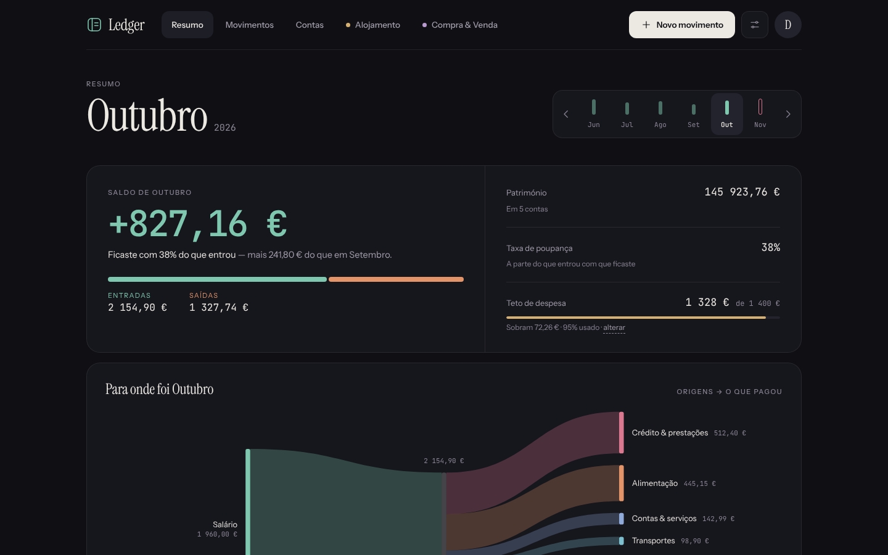</td>
</tr>
</table>

### Dark and light
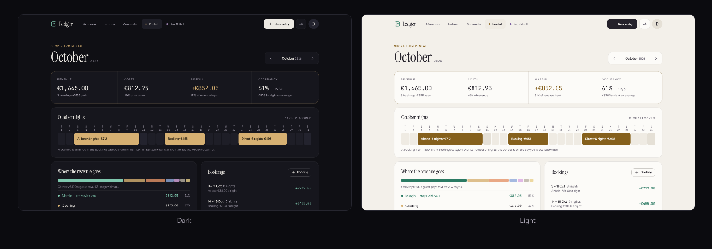

<details>
<summary>The page before signing in</summary>
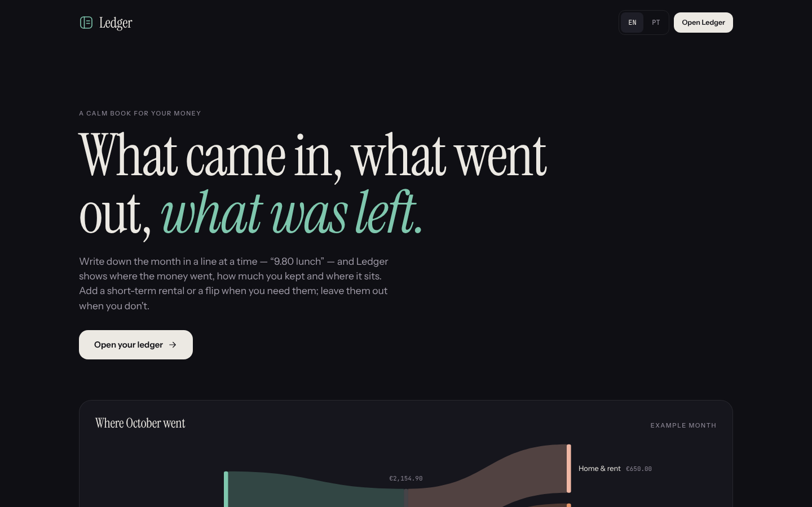
</details>

The pictures are the [demo](#demo-mode): made-up numbers.

## Deploying on the NAS

Ledger joins the other apps on Prometheus: its own folder in `/volume3/docker/self-hosted`, the **shared SQL Server**
and a **Portainer stack** managed by `apps.sh`. Run these over SSH.

**The short way**: clone it and let the script do the rest — the `.env` (secrets generated, sa taken from
`shared-sql`), the `ledger` password in `shared-sql`'s `.env` and in its variables in Portainer, the build, `apps.py`,
the stack, the checks and the Homepage card. It's safe to run again.

```bash
cd /volume3/docker/self-hosted
sudo docker run --rm -v "$PWD:/git" -w /git alpine/git clone https://github.com/rodrigocoelho2/Ledger.git Ledger
sudo bash Ledger/deploy/prometheus-setup.sh
```

**Where the variables live**: in the `.env` next to `docker-compose.yml` (and in `shared-sql/.env`). `apps.sh` sends
them to the stack's variables in Portainer on every `migrar`/`atualizar`, so you see them there — but a change made only
in Portainer is overwritten by the next update. Change the `.env`, then `apps.sh atualizar ledger`.

**Step by step**, if you'd rather:

**1. Get the code and fill in `.env`**

```bash
cd /volume3/docker/self-hosted
git clone https://github.com/rodrigocoelho2/Ledger.git Ledger
cd Ledger
cp .env.example .env
nano .env
```

- `SQL_SA_PASSWORD`: the same as in `shared-sql/.env`.
- `SQL_APP_PASSWORD`: a new password for the `ledger` login (letters and numbers; `.env.example` has a one-liner that
  makes one). Keep it in Vaultwarden. You don't create the login: db-deploy does.
- `LEDGER_API_KEY`, `LEDGER_SETUP_KEY`: two more random strings.

**2. Build it, and make the volume for the sign-in keys**

```bash
sudo docker compose build
sudo docker volume create ledger_keys
```

**3. Add it to `apps.py` and create the stack**

In `/volume3/docker/_scripts/apps/apps.py`, add one line to `APPS`:

```python
    "ledger":      ("Ledger",      "ledger"),
```

then:

```bash
sudo bash /volume3/docker/_scripts/apps/apps.sh migrar ledger
```

The stack comes up in Portainer: `ledger-db-deploy` runs once and exits (database and login), then `ledger-webapi` and
`ledger-website`. Open `http://<nas-ip>:5100` and create the first account with the setup key.

**4. Reach it** — it's personal money, so like Obol it's best kept to Tailscale. If you do want it outside: in Nginx
Proxy Manager, a proxy host `ledger.prometheus-nas.com` → `ledger-website`, port `8080` (the website is on `nas-net`).

**Updating** after a push to `main`:

```bash
sudo bash /volume3/docker/_scripts/apps/apps.sh atualizar ledger
```

It pulls, builds on the NAS, redeploys the stack (db-deploy applies any schema change) and cleans old images. If the
build fails, the running version stays.

### Anywhere else

`docker-compose.yml` expects a SQL Server called `shared-sql` on a Docker network called `sql-net`. With your own SQL
Server, set `SQL_SERVER` in `.env` to its container name (on `sql-net`) and run
`docker network create nas-net && docker compose up -d --build`.

## Demo mode

Set `LEDGER_DEMO_MODE=true` in `.env` (or `Ledger__DemoMode=true` on the WebApi) and Ledger runs on a **sample ledger
in memory** — no database is touched. Sign in as **`demo`** / **`ledger-demo`** (the sign-in page has a *Try it*
button). It's six months of one person's money ending today, a flat rented by the night for the last four, one property
bought, renovated and sold and another just started; the last full month always comes to **+€827.16**. It starts over
whenever the app restarts.

## Your data

Settings → **Your data**:

- **Export** as **CSV** (opens in Excel or Numbers; `;`-separated, in your language) or **JSON** (the complete backup:
  accounts, projects, caps and every entry).
- **Import** either back — also the files of the **old single-file Ledger** (`ledger.html`), CSV or JSON, Portuguese
  headers and category names included. Entries that are already there are skipped, so importing the same file twice is
  safe. Accounts and projects it names are created.
- **Start over**: erases every entry, account, project and cap, and leaves the four starter accounts. Export first.

## Your bank (Enable Banking)

Optional. Ledger reads your own accounts — never moves money — through Enable Banking, free for personal use.

1. Sign up at [enablebanking.com](https://enablebanking.com) and open the **Control panel → Applications → Add a new
   application**: environment **Production**, redirect URL `https://<where you open Ledger>/bank/callback` (it must be
   HTTPS: the Nginx Proxy Manager address, or a `tailscale serve` one), and **generate the private key in the
   browser**. It downloads as `<application-id>.pem`.
2. On the application, **Activate by linking accounts** and link your own account at your bank: the free plan only
   reads the accounts linked there.
3. Put the `.pem` next to `docker-compose.yml` on the NAS and run `deploy/prometheus-setup.sh` again — it puts
   `ENABLEBANKING_APP_ID` and `ENABLEBANKING_KEY` (the key in base64) into `.env` and updates Ledger. Elsewhere, set
   them by hand: `ENABLEBANKING_KEY=$(base64 -w0 <application-id>.pem)`.
4. In Ledger: **Settings → Bank → Go to the bank**, sign in at the bank, pick the account. Back in Ledger, choose the
   account its movements go into (or a new one) and the first day to bring. Done: it syncs every `BANK_SYNC_HOURS`
   (8 by default; banks allow about four syncs a day without you), and **Sync now** whenever you like.

The bank's authorisation lasts 90 to 180 days; when it ends, Settings says so and **Go to the bank** renews it —
nothing is lost. If the bank sends you back to an address that isn't Ledger's (one registered for another place you
open it from), copy that address and paste it in **Settings → Bank**.

## Investments from Obol

Optional. Set `OBOL_API_KEY` (the same as in Obol's `.env`; the setup script copies it) and, if Obol isn't at
`http://obol-webapi:8080` on `sql-net`, `OBOL_URL`. Then open the investments account, set **Balance → Its value in
Obol**, and the Obol user name if it isn't the same as in Ledger. Transfers into that account still show as entries
but don't move its value — Obol already counts the money.

## Sign in with Discord

Optional:

1. At [discord.com/developers/applications](https://discord.com/developers/applications) use the application of your
   other apps (or make one). In **OAuth2**, copy the **Client ID** and the **Client Secret**, and under **Redirects**
   add `https://<where you open Ledger>/signin-discord` (one per address).
2. Put them in `.env` as `DISCORD_CLIENT_ID` and `DISCORD_CLIENT_SECRET`, and update Ledger.
3. Already have an account? Sign in with your password, open **Settings → Discord → Link Discord**. From then on
   **Sign in with Discord** opens that same account, with everything in it.
4. Someone new presses **Sign in with Discord**, picks a user name, and has an account with no password. They can add
   one in Settings; until then Discord can't be unlinked, so nobody gets locked out.

Ledger only asks Discord who you are (the `identify` scope). New accounts through Discord follow
`LEDGER_ALLOW_REGISTRATION`.

## Development

```
Ledger.Database   SQL Server project: tables, stored procedures, and the app login (post-deploy) → dacpac
Ledger.Library    shared enums, the categories (both languages), amounts, ServiceApiResponse, validation
Ledger.WebApi     the engine: users, accounts, entries, overview, rental, projects, settings, export/import, demo
Ledger.Sdk        typed client of the WebApi (the Website's only way in)
Ledger.Website    the app: ASP.NET Core MVC, Razor views, one stylesheet and one script, a PWA
Ledger.UnitTest   the money maths, quick add, categories, the files, the demo ledger, the services, the SDK contract
```

- Every database call is a stored procedure through Dapper; no SQL in C#. The sums (overview, rental, projects,
  balances) are plain C# over the month's entries, so the SQL and the in-memory repositories give the same answers.
- The Website never references the WebApi: `Ledger.Sdk` carries copies of the DTOs, and a test checks they match.
- Every word on screen is in both languages next to each other (`L.T("Entries", "Movimentos")`); the WebApi's
  validation messages follow the request's `Accept-Language`.
- Builds and checks happen on the NAS (`apps.sh atualizar ledger`).
- Locally: run both projects with demo mode on — no database needed:

  ```bash
  Ledger__ApiKey=dev Ledger__DemoMode=true dotnet run --project Ledger.WebApi        # :5101
  LedgerApi__ApiKey=dev dotnet run --project Ledger.Website                          # :5100
  ```

  Or copy the two `appsettings.Development.json.example` files to `appsettings.Development.json` and point the WebApi
  at a SQL Server.

---

<p align="center"><sub>Ledger isn't affiliated with Airbnb or Booking.com. Not financial advice: it only adds up what you type in.</sub></p>
